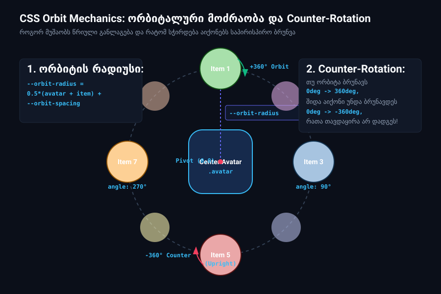

# დავალება — CSS Orbiting Menu: ორბიტალური ანიმაცია და წრიული მათემატიკა

## მიზანი

ეს დავალება მიზნად ისახავს თანამედროვე CSS-ის ყველაზე ძლიერი და შთამბეჭდავი შესაძლებლობების პრაქტიკულ ათვისებას:
1. **რთული წრიული მოძრაობა (Orbital Motion):** როგორ განვალაგოთ ელემენტები წრეზე და როგორ ვატრიალოთ ისინი საერთო ცენტრის გარშემო JavaScript-ის გარეშე.
2. **`transform-origin`-ის მათემატიკა:** ბრუნვის ღერძის გადატანა ობიექტის საზღვრებს გარეთ.
3. **Counter-Rotation (საპირისპირო ბრუნვა):** როგორ ავირიდოთ თავიდან აიქონების თავდაყირა დადგომა ორბიტალური ტრიალის დროს.
4. **CSS Custom Properties & `calc()`:** დინამიკური პარამეტრები, რომლებიც ერთმანეთზეა დამოკიდებული (რადიუსი, კუთხე, სიჩქარე).
5. **მდიდარი მიკრო-ინტერაქციები (Micro-interactions):** პულსაცია, ჰოვერზე ანიმაციის დაპაუზება (`animation-play-state: paused`), და მონაცემთა ატრიბუტიდან ტექსტის ამოკითხვა (`content: attr(data-category)`).

---

## 🎯 მუშა მაგალითი (Live Demo)

საქაღალდეში უკვე დევს სრულად მომუშავე მაგალითი. სანამ დავალების შესრულებას დაიწყებდე:
- გახსენი ბრაუზერში ფაილი: [**`demo/index.html`**](./demo/index.html).
- დააკვირდი ანიმაციის დინამიკას, ელემენტების ბრუნვას და ჰოვერ ეფექტებს.
- ორიგინალი ინსპირაცია: [CodePen — Orbiting Menu (CSS Only) by Larento](https://codepen.io/larento/pen/GRdxrJv).

---

## 🖼️ ვიზუალური რეფერენსი

### ორბიტის მექანიკა და Counter-Rotation:


---

## 📐 ანიმაციის ანატომია და მათემატიკა (The Math Behind Orbit)

ამ ანიმაციის მთავარი საიდუმლო სუფთა CSS ტრიგონომეტრიასა და ცვლადებშია:

### 1. ორბიტის რადიუსი (`--orbit-radius`):
მანძილი ცენტრიდან თითოეულ წრემდე ითვლება ფორმულით:
```css
--orbit-radius: calc(
  0.5 * (var(--avatar-size) + var(--item-size)) + var(--orbit-spacing)
);
```
- ნახევარი ავატარის ზომა + ნახევარი ელემენტის ზომა + თავისუფალი სივრცე (`spacing`).

### 2. კუთხე წრეზე (`--angle`):
წრეში არის $360^\circ$. თუ გვაქვს 8 ელემენტი (`--orbit-items: 8`):
```css
--orbit-step: calc(360deg / var(--orbit-items)); /* 45deg */
--angle: calc(var(--pos) * var(--orbit-step));   /* 0deg, 45deg, 90deg, 135deg... */
```
თითოეულ ელემენტს HTML-ში მინიჭებული აქვს თავისი პოზიცია `--pos: 0` ... `--pos: 7`.

### 3. `transform-origin` მაგია:
ჩვეულებრივ, ელემენტი ბრუნავს საკუთარი ცენტრის გარშემო (`transform-origin: 50% 50%`).
მაგრამ თუ ბრუნვის ღერძს გადავწევთ ქვემოთ რადიუსის მანძილზე:
```css
transform-origin: 50% calc(50% + var(--orbit-radius));
```
ელემენტი დაიწყებს წრეზე მოძრაობას, როგორც პლანეტა მზის გარშემო!

### 4. Counter-Rotation (საპირისპირო როტაცია):
როდესაც ორბიტა ბრუნავს საათის ისრის მიმართულებით ($0^\circ \to 360^\circ$), მასზე მიმაგრებული აიქონიც ტრიალებს და ორბიტის ქვედა ნაწილში აღმოჩნდება **თავდაყირა**!
- ამის თავიდან ასაცილებლად, აიქონის შიდა კონტეინერს (`.item-wrap`) ვატრიალებთ ზუსტად იმავე სიჩქარით, ოღონდ **საპირისპირო მიმართულებით** ($0^\circ \to -360^\circ$).
- ორი როტაცია ერთმანეთს აბათილებს და აიქონი ყოველთვის სწორად (Upright) რჩება!

---

## 📁 სამუშაო ფაილების სტრუქტურა

```text
animation/
├── README.md               <-- ეს გზამკვლევი და ინსტრუქცია
├── index.html              <-- სტუდენტის საწყისი HTML (სტრუქტურა + SVG-ები)
├── style.css               <-- სტუდენტის სამუშაო CSS (TODO სექციებით)
├── demo/                   <-- მუშა მაგალითი (შესამოწმებლად და სანახავად)
│   ├── index.html
│   └── style.css
└── assets/
    └── orbit-mechanics.svg <-- მექანიკის ვექტორული სქემა
```

---

## 🛠️ დავალების ეტაპები (ნაბიჯ-ნაბიჯ)

გახსენი [**`style.css`**](./style.css) და მიჰყევი კომენტარებში მოცემულ ნაბიჯებს:

### ნაბიჯი 1 — ცენტრალური ბირთვის განლაგება
1. `.menu` ელემენტი გახადე Grid კონტეინერი და გააცენტრე შიგთავსი (`place-items: center`).
2. `.avatar` ელემენტი განათავსე ცენტრში (`grid-area: 1 / -1`).
3. მიანიჭე მუქი ლურჯი ფონი `#162a4c`, და მომრგვალებული კუთხეები:
   ```css
   border-radius: calc(0.31 * var(--size));
   ```

---

### ნაბიჯი 2 — ორბიტის ელემენტების წრიული განლაგება
1. `.orbit` ელემენტიც განათავსე იმავე ბადეზე (`grid-area: 1 / -1; display: grid; place-items: center;`).
2. `.orbit li` ელემენტებს მიანიჭე:
   - `grid-area: 1 / -1;` (ყველა ერთ წერტილში იწყებს).
   - `bottom: var(--orbit-radius);` (რადიუსით აიწიოს ზემოთ).
   - `transform-origin: 50% calc(50% + var(--orbit-radius));` (ბრუნვის ცენტრი გადავიდეს ავატარის ცენტრში).
   - `transform: rotate(calc(-1 * var(--angle) + var(--orbit-phase)));` (თითოეული ელემენტი დაჯდეს თავის კუთხეზე).

> **შედეგის შემოწმება:** ამ ეტაპზე 8-ვე ფერადი წრე უკვე თანაბრად უნდა იყოს გადანაწილებული ცენტრალური ავატარის ირგვლივ!

---

### ნაბიჯი 3 — მთავარი ორბიტალური ანიმაცია (`@keyframes orbit`)
1. შექმენი ანიმაცია:
   ```css
   @keyframes orbit {
     from { transform: rotate(0deg); }
     to   { transform: rotate(360deg); }
   }
   ```
2. მიაბი `.orbit`-ს:
   ```css
   animation: orbit linear var(--orbit-dur) var(--orbit-delay) both infinite;
   ```

---

### ნაბიჯი 4 — Counter-Orbit ანიმაცია (`.item-wrap`)
1. შექმენი საპირისპირო ბრუნვის ანიმაცია:
   ```css
   @keyframes counter-orbit {
     from { transform: rotate(calc(0deg + var(--angle) - var(--orbit-phase))); }
     to   { transform: rotate(calc(-360deg + var(--angle) - var(--orbit-phase))); }
   }
   ```
2. მიანიჭე `.item-wrap`-ს საწყისი ტრანსფორმაცია და მიაბი `counter-orbit` ანიმაცია ზუსტად იმავე ხანგრძლივობით (`var(--orbit-dur)`).

---

### ნაბიჯი 5 — ინტერაქციები და Hover ეფექტები
1. **პულსაციის ანიმაცია:** `.item`-ს დაამატე `@keyframes throbbing`, რომელიც ელემენტს ოდნავ ადიდებს (`scale(0.95)`-დან `scale(1.05)`-მდე). გამოიყენე `calc(1s + var(--pos) * 0.15s)` დაყოვნება, რათა ყველა წრე ერთდროულად არ პულსირებდეს!
2. **დაპაუზება:**
   - როდესაც მაუსს მივიტანთ ორბიტაზე ან კონკრეტულ ელემენტზე, ბრუნვა უნდა შეჩერდეს:
     ```css
     .orbit:hover,
     .orbit:hover .item-wrap,
     .item:hover {
       animation-play-state: paused;
     }
     ```
3. **Tooltip-ის გამოჩენა:**
   - `.item::after` ფსევდოელემენტით გამოაჩინე კატეგორიის სახელი:
     ```css
     content: attr(data-category);
     ```
   - ჰოვერზე აიქონი აწიე ზემოთ (`translateY(-2.65em)`), ხოლო ტექსტი გახადე ხილვადი (`opacity: 1; transform: scale(1);`).

---

### ნაბიჯი 6 — ორბიტის ინტერაქციული გაფართოება
როდესაც მაუსს მივიტანთ ცენტრალურ ავატარზე (`.avatar`), ორბიტა უნდა „გაიშალოს“ და რადიუსი გაიზარდოს:
```css
.avatar:hover ~ .orbit {
  --orbit-spacing: 6em;
}
```
*(რადგან ყველა რადიუსი CSS ცვლადებზეა აწყობილი, `--orbit-spacing`-ის შეცვლით ბრაუზერი ავტომატურად გადათვლის მთელ ორბიტას!)*

---

## 🚀 დამატებითი გამოწვევა (Optional Challenges)

თუ გსურს შენი ანიმაცია კიდევ უფრო დახვეწო:
1. **Reverse Orbit:** დაამატე ღილაკი ან კლასი, რომელიც ორბიტას საპირისპირო მიმართულებით აატრიალებს.
2. **დინამიკური სიჩქარე:** გაზარდე ან შეამცირე ბრუნვის დრო (`--orbit-dur: 20s`).
3. **ახალი ელემენტის დამატება:** სცადე მე-9 ელემენტის ჩამატება HTML-ში და ნახე, როგორ გადაითვლის CSS კუთხეებს (`--orbit-items: 9`).

---

## 📋 ჩაბარების პირობები

1. დავალება სრულდება **მხოლოდ სუფთა HTML-ითა და CSS-ით**.
2. გამოყენებულია CSS ცვლადები და `calc()` ფორმულები წრიული განლაგებისთვის.
3. რეალიზებულია Counter-Rotation მექანიზმი — აიქონები ბრუნვის დროს არ ტრიალებს თავდაყირა.
4. მუშაობს Hover ეფექტები (დაპაუზება, ტექსტის გამოჩენა და ორბიტის გაფართოება).
5. პროექტი ატვირთე GitHub-ზე და გაუშვი Live Demo.

